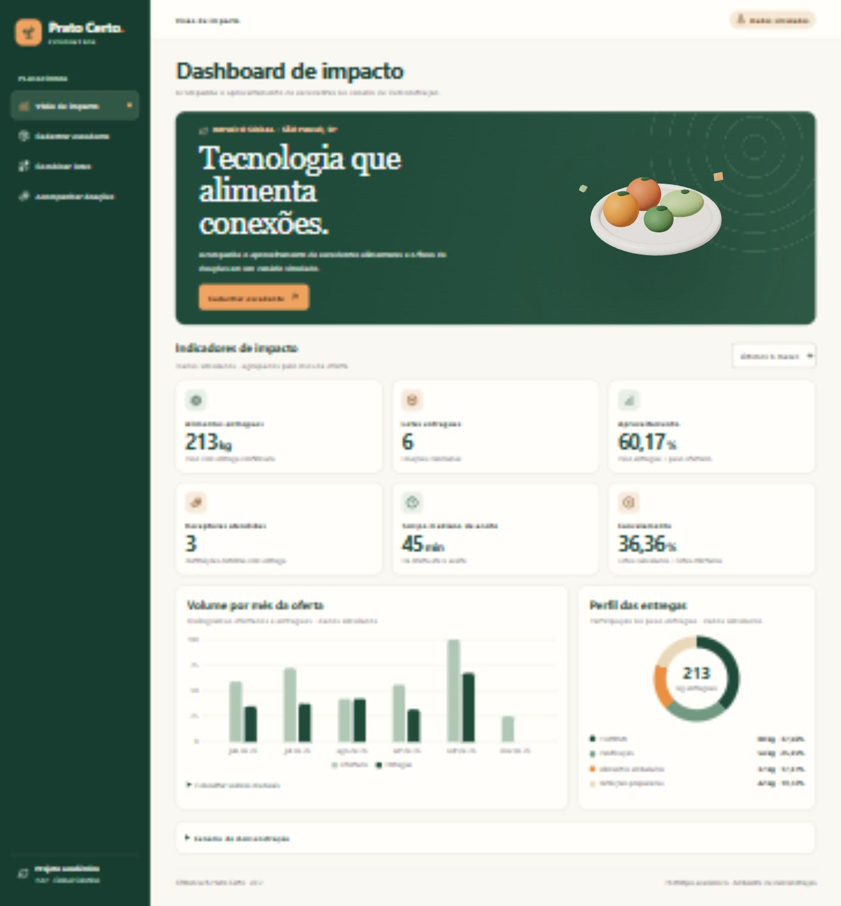
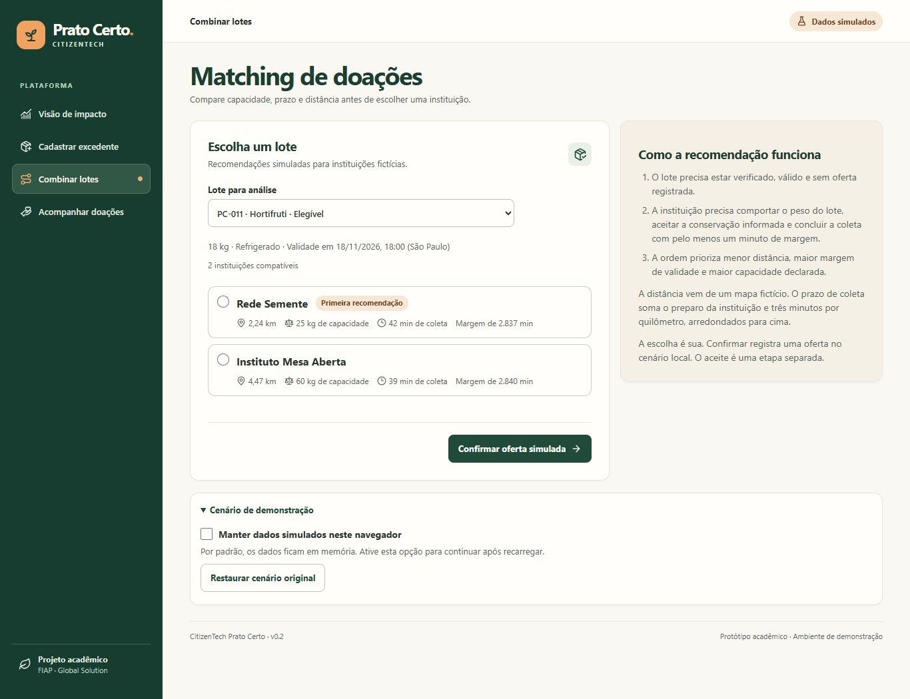

# Prato Certo · v0.2

Protótipo acadêmico CitizenTech para a Global Solution da FIAP. A proposta aproxima estabelecimentos com excedentes alimentares de organizações que podem recebê-los. A demonstração usa um cenário fictício inspirado em São Paulo e se relaciona com os ODS 2 e 12. Todos os lotes, instituições, distâncias, doações e indicadores são **simulados**.

## Demonstração

| Dashboard de impacto | Recomendações de instituições |
| --- | --- |
|  |  |

1. Abra **Combinar lotes** e escolha **PC-011** para comparar as instituições compatíveis. A ordem ajuda na escolha. Selecione uma instituição e confirme para registrar a oferta simulada.
2. Em **Acompanhar doações**, abra o mesmo lote e registre aceite, retirada e entrega. Confira o efeito no dashboard filtrando pelo mês da oferta.
3. Cadastre um excedente. Ele fica pendente de verificação sanitária humana e indisponível para oferta. O lote **PC-013** demonstra o mesmo bloqueio.
4. Em **Cenário de demonstração**, ative a persistência opcional ou restaure o cenário original.

## Execução local

Use Node.js **22.18 ou superior** com npm.

```sh
npm ci
npm run dev
```

Abra o endereço mostrado pelo Vite, normalmente `http://localhost:5173`.

| Comando | Finalidade |
| --- | --- |
| `npm run dev` | Servidor local com atualização durante o desenvolvimento |
| `npm test` | Testes de validação, integridade, matching, histórico e indicadores |
| `npm run build` | Verificação TypeScript e build estático em `dist/` |
| `npm run preview` | Visualização local do build |

## Arquitetura e stack

| Camada | Versão 0.2 | Proposta acadêmica |
| --- | --- | --- |
| Interface | React, TypeScript, Vite, Tailwind CSS e Lucide | Portal para estabelecimentos e instituições |
| Interação | GSAP na abertura e nas sugestões, Motion nos indicadores, navegação e ações, Three.js com React Three Fiber na abertura e Lenis na rolagem do dashboard | Validação de usabilidade e acessibilidade em piloto |
| Regras e dados | Cenário em `src/mock.ts`, regras em `src/model.ts`, agregações em `src/metrics.ts` | Avaliação sanitária humana, regras de qualidade e priorização explicável |
| Armazenamento | Estado React e cópia opcional no `localStorage` do navegador | API e banco relacional com controle de acesso, rastreabilidade e auditoria |

O aplicativo roda no cliente. A interface respeita a preferência do sistema por movimento reduzido. A composição Remotion existente continua em `pitch/video/`.

## Metodologia dos dados

O cenário inicial gera 15 lotes e três instituições fictícias. Os períodos históricos e as validades iniciais são relativos à abertura sem cenário salvo ou à restauração. Um lote pode ter uma oferta vinculada a uma instituição e um histórico de etapas. O status atual é a última etapa registrada, ou o estado da verificação sanitária quando ainda não há oferta. O CSV em `data/` é um exemplo acadêmico independente e fica fora do fluxo da aplicação.

Dashboard, matching e acompanhamento consultam o mesmo conjunto de lotes. Os períodos incluem o mês atual e agrupam pelo mês UTC da **primeira oferta**. Uma entrega em mês posterior continua no grupo da oferta. O peso de entrega corresponde ao lote inteiro neste cenário. Os horários de acompanhamento aparecem no fuso de São Paulo.

| Indicador | Fórmula |
| --- | --- |
| Peso ofertado | Soma dos pesos com oferta no período, incluindo canceladas |
| Peso entregue | Soma dos pesos com status final Entregue entre as ofertas do período |
| Lotes entregues | Contagem dos lotes com status final Entregue entre as ofertas do período |
| Aproveitamento | 100 × peso entregue ÷ peso ofertado |
| Receptoras atendidas | Contagem de instituições distintas com pelo menos uma entrega nesse conjunto |
| Tempo mediano de aceite | Mediana dos minutos entre oferta e aceite entre lotes com evento de aceite |
| Cancelamento | 100 × quantidade de lotes cancelados ÷ quantidade de lotes ofertados |
| Perfil das entregas | Peso entregue por categoria e 100 × peso da categoria ÷ peso total entregue |

O gráfico mensal aplica as mesmas fórmulas de peso dentro de cada mês. Indicadores sem denominador ou amostra exibem um traço.

### Matching e transições

A recomendação exige lote com verificação registrada no cenário, validade futura e nenhuma oferta anterior. A instituição precisa comportar o peso integral, aceitar o tipo de conservação e ter pelo menos um minuto de margem. A distância euclidiana usa pontos fictícios em quilômetros. O prazo estimado soma o tempo de preparo declarado e o arredondamento para cima de três minutos por quilômetro. A margem é o tempo restante até a validade menos esse prazo, em minutos inteiros.

Entre instituições compatíveis, a ordem é menor distância, maior margem, maior capacidade e código estável da instituição. A capacidade é declarada por lote. A pessoa escolhe e confirma a oferta. A aplicação revalida a elegibilidade no momento da confirmação. A jornada simulada segue oferta → aceite → retirada → entrega, com cancelamento possível antes de concluir.

## Segurança e limites

Os formulários usam campos de domínio fechados e valores de peso e validade. O projeto usa somente dados fictícios e não coleta nomes de pessoas, RMs, contatos, coordenadas reais ou dados de beneficiários. A cópia opcional fica vinculada ao navegador e à origem local. O formato e o histórico são validados ao carregar. Use uma aba por cenário para evitar que a última gravação substitua alterações de outra aba.

A simulação não tem backend, autenticação, sincronização, cálculo real de rotas, notificações ou atestação sanitária. A interface não permite aprovar sanitariamente novos lotes. As verificações iniciais são marcadores fictícios para demonstrar o fluxo. O produto não realiza doações reais nem estima refeições a partir de quilogramas.

## Roadmap

- Validar critérios, capacidade e janelas de coleta com operadores e organizações.
- Testar tarefas completas com leitores de tela e dispositivos de baixa capacidade.
- Especificar trilha de auditoria, autorização, retenção e revisão humana antes de qualquer piloto real.

## Validação e documentos

`npm test` aprovou **11 testes** e `npm run build` gerou o bundle estático. O Vite sinaliza o tamanho do módulo 3D, carregado sob demanda. O fluxo de recomendação, oferta, entrega, persistência e restauração foi conferido no navegador, assim como a navegação em largura móvel.

A documentação acadêmica está na [proposta executiva](docs/proposta-executiva.md), na [base de governança](docs/governanca-base.md) e no [diagrama de fluxo](architecture/fluxo-dados.mmd).
